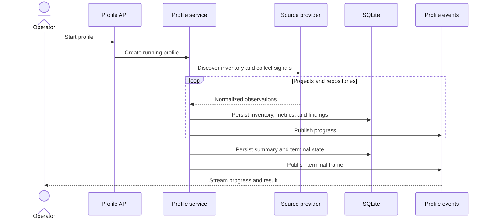
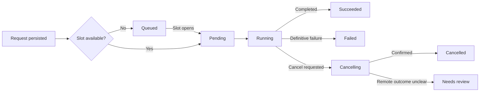
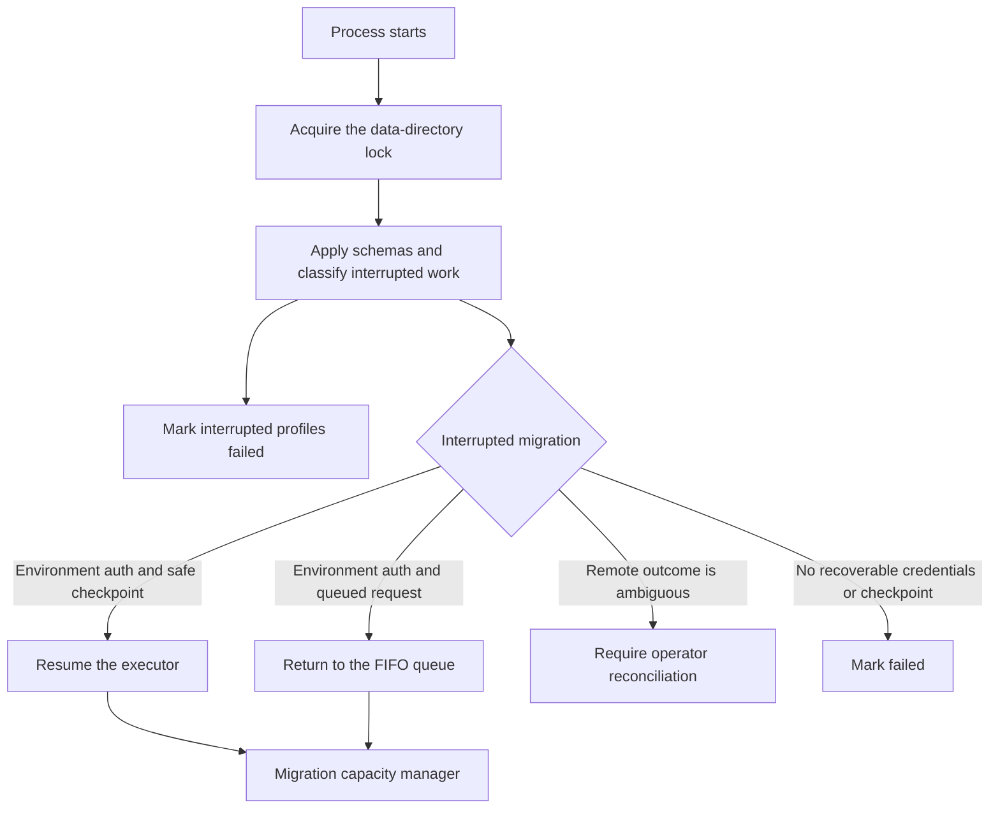

# Architecture

The dashboard is a single Bun process serving a SvelteKit application and a
SQLite database. Its server code is split into `core`, `source`, `profile`, and
`migrate` domains behind an explicit application composition layer.

- [Migration pipeline](#migration-pipeline)
- [Profile flow](#profile-flow)
- [Concurrency and recovery](#concurrency-and-recovery)
- [Operational boundaries](#operational-boundaries)
- [Real-time progress](#real-time-progress)
- [Authentication](#authentication)
- [Persistence](#persistence)
- [Domain boundaries](#domain-boundaries)

## Profile flow

Profile runs gather provider inventory and repository signals, persist
normalized results, and evaluate migration readiness. GitHub uses organization and
repository crawls; GitLab and Bitbucket Server use their provider adapters to
discover projects and collect project metrics. The profile domain owns the run
lifecycle and analysis in both cases.

## Migration pipeline

The migration manager selects an executor from the source provider and target
platform, persists the request, and submits it to an app-wide FIFO queue.

<!-- BEGIN GENERATED: support-matrix -->
| Source | Target | Executor |
|---|---|---|
| GitHub | GitHub Enterprise Cloud | `github-api` |
| GitHub | GitHub Enterprise Server | Not supported |
| GitLab | GitHub Enterprise Cloud | `gitlab-native` |
| GitLab | GitHub Enterprise Server | `gitlab-ghes` |
| Bitbucket Server | GitHub Enterprise Cloud | `bitbucket-server-native` |
| Bitbucket Server | GitHub Enterprise Server | `bitbucket-server-ghes` |
<!-- END GENERATED: support-matrix -->

<!-- BEGIN GENERATED: migration-lifecycle -->
**Migration states:** `queued`, `pending`, `running`, `cancelling`, `succeeded`, `failed`, `cancelled`, `reconciliation_required`.

**GHEC observation phases:** `QUEUED`, `PENDING_VALIDATION`, `EXPORTING`, `IMPORTING_GIT`, `IMPORTING_METADATA`, `SUCCEEDED`, `FAILED`, `UNKNOWN`.
<!-- END GENERATED: migration-lifecycle -->

Every executor reports the same top-level lifecycle. All GHEC targets use
GitHub's migration GraphQL API to create a migration source and start and monitor
the target import. GitHub sources use the GitHub archive path; a GHEC source
needs no explicit archive URLs, while a GHES source exports archives first.
GitLab and Bitbucket Server use provider-native source exports, upload those
archives through GitHub's archive API, and then start the same repository
migration mutation. The executor IDs identify the source-side strategy.

GHES targets use containerized GitLab or Bitbucket Server exporters plus
`ghe-migrator` instead of the GitHub migration APIs.

For GHEC targets, execution progresses through provider-specific preflight,
archive/export, upload, import start, monitoring, and completion operations.
The final successful observation supplies persisted resource counts so
post-migration indexing lag cannot overwrite them with transient zeroes.

### GHES imports

GitLab and Bitbucket Server can target an administrator-configured GHES
profile. A one-shot exporter writes an archive into the shared archive volume.
The dashboard verifies its hash, transfers it over host-key-pinned SSH, then
runs the prepare, mapping, import, audit, unlock, and cleanup operations.
Exporter containers never receive GHES credentials.

<!-- BEGIN GENERATED: ghes-import-phases -->
**GHES import phases:** `pending`, `exporting`, `archive_ready`, `transferring`, `preparing`, `mapping`, `importing`, `auditing`, `unlocking`, `succeeded`, `failed`, `cancelled`, `reconciliation_required`.
<!-- END GENERATED: ghes-import-phases -->

Ambiguous remote writes are never replayed automatically. An interruption
during prepare, mapping, or import becomes `reconciliation_required` when the
dashboard cannot prove whether the remote operation completed.

## Concurrency and recovery

The manager enforces one app-wide limit of ten executing migrations. Requests
beyond capacity remain durable in `queued` state. When an execution promise
settles, a transactional dequeue claims the oldest recoverable item and starts
it. Batch migrations use the same queue; a batch is durable membership and
identity metadata rather than a second execution mechanism.

On startup, queued requests using server-owned environment PAT or GitHub App
credentials are re-enqueued. Executing migrations using those credentials can
resume from persisted GitHub, native export, or GHES import checkpoints when
the next action is safe to repeat. Per-request credentials are never persisted,
so work that depends on them is not crash-recoverable.

An interrupted profile is retained as failed audit history and must be run
again. A migration enters `reconciliation_required` when repeating a remote
write could duplicate or corrupt work; the operator must inspect the source and
target, confirm the remote outcome, and then start a new attempt.

The process holds an exclusive lock in its data directory for its lifetime.
This keeps in-memory queue ownership, SQLite state, and recovery decisions
single-writer even when deployment configuration accidentally requests more
than one process.

## Operational boundaries

| Boundary | Current behavior |
|---|---|
| Source and target support | GitHub can target GHEC. GitLab and Bitbucket Server can target GHEC or a configured GHES profile. GitHub-to-GHES is not supported. |
| Migration capacity | At most ten migrations execute app-wide. Additional requests remain durable in FIFO order. |
| Batch size | A batch accepts at most 500 repository mappings and uses the same queue as single migrations. |
| Profile capacity | One profile per source provider can run at a time. |
| Source inventory | GitLab and Bitbucket inventories stop at the provider-neutral 10,000-project envelope. |
| Durable state | Migration requests, states, events, batches, and acknowledged provider, GitHub, and GHES checkpoints survive a restart. |
| Process-local state | Active controllers, API clients, and request-scoped credentials do not survive a restart. Interrupted profiles are marked failed. |

Provider-specific constraints also apply:

- GitHub sources can target GHEC only.
- GitLab exports are bounded by archive-size and download-timeout settings;
	GitLab-to-GHES requires the configured external exporter.
- Bitbucket Server and Data Center discovery enforces the supported server
	version. Native GHEC exports require pinned SFTP access to shared home, while
	GHES migrations require the configured external exporter.

See [Provider Contracts](provider-contracts.md) for collection behavior and
[Configuration](configuration.md) for operator-set bounds and prerequisites.

## Real-time progress

Migration progress is delivered with Server-Sent Events:

- `/api/migrate/[id]/events` streams one migration.
- `/api/migrate/events` streams dashboard-wide activity.

Event IDs are durable SQLite sequence values. Reconnecting clients send a
cursor, receive a bounded replay window, and then subscribe to live events.
Malformed, stale, or future cursors are handled explicitly so reconnects do not
silently skip history.

Profile progress uses `/api/profile/[id]/events`. Profile runs persist terminal
state before publishing their final frame, allowing a reconnect to recover the
result even if it missed the live event.

## Authentication

GitHub source and target credentials are resolved independently. The supported
modes are request PAT, request GitHub App, environment PAT, and environment
GitHub App. Request credentials take precedence only when credential override
is enabled. GitLab and Bitbucket credentials are server-owned.

Dashboard users and sessions are stored in SQLite. Passwords use Argon2id.
Browser cookies contain random 32-byte session tokens; only SHA-256 token
digests are persisted. Session resolution in the request hook populates the
authenticated user in request locals, which is the sole downstream identity
source. Disabled users, expired sessions, and revoked sessions are rejected.

Administrators manage users, while operators retain all profiling and migration
permissions. User administration and successful operator mutations append
durable audit events. Failed sign-ins are throttled by username/address pair and
client address without permanently locking a user. When authentication is
enabled, the root layout returns only `authEnabled` until a user is resolved, so
operational names and failures are not serialized to unauthenticated clients.

## Persistence

SQLite runs in WAL mode with foreign keys enabled. Domain schemas are applied
in dependency-safe order by `src/lib/server/schemas.ts`; startup hooks perform
schema upgrades, interrupted-run recovery, and retention pruning.

<!-- BEGIN GENERATED: durable-tables -->
| Table | Purpose | Notes |
|---|---|---|
| `app_users` | Dashboard user identities and credentials | Usernames are unique case-insensitively; passwords are stored as Argon2id hashes |
| `app_sessions` | Revocable dashboard sessions | Stores SHA-256 token digests, never raw cookie values |
| `auth_login_attempts` | Persistent sign-in throttling | Bounded failed attempts keyed by username and client address |
| `audit_events` | Authentication and operator action attribution | Stores actors and resources without credentials or session tokens |
| `app_schema_versions` | Per-domain schema versions | Supports idempotent startup upgrades |
| `migrations` | One row per repository migration | Includes batch ID, source provider, native and GitHub checkpoints, state, pipeline step, auth mode, request options, counts, and timestamps |
| `events` | Append-only migration event log | Replayed for SSE catch-up |
| `ghes_import_jobs` | Durable exporter-to-GHES import state | Stores exporter identity, archive path and hash, ghe-migrator GUID, source lock state, phase, and failure reason |
| `migration_batch_items` | Durable batch membership | Enforces unique source and target identities per batch |
| `profile_runs` | Profile lifecycle and rollups | Stores provider, namespace, counters, API calls, timestamps, and terminal failure |
| `profile_repos` | Repository analysis within a profile | Idempotent per run and repository; queried in filtered pages |
| `profile_source_inventories` | Provider-neutral inventory summary | One normalized summary per profile run |
| `profile_source_inventory_projects` | Source inventory projects | Ordered, normalized project rows for paginated access |
| `profile_source_project_profiles` | Provider-specific project profiles | Stores normalized per-project profile payloads keyed to inventory rows |
<!-- END GENERATED: durable-tables -->

There is no separate batch aggregate table. Migrations carry `batch_id`, while
`migration_batch_items` enforces durable source and target identity within a
batch. Profile inventories store metadata separately from ordered project rows
so large profiles can be filtered and paginated without loading one unbounded
JSON payload.

## Domain boundaries

The server layers are:

| Path | Responsibility |
|---|---|
| `src/lib/server/application/` | Cross-domain use cases, request policy, startup reporting, and concrete adapters for domain-owned ports |
| `src/lib/server/core/` | Database primitives, GitHub auth and clients, sessions, SSE, and shared infrastructure |
| `src/lib/server/source/` | GitLab and Bitbucket clients, discovery, profiling, export, and provider configuration |
| `src/lib/server/profile/` | Provider-neutral profile lifecycle, analysis, events, and persistence |
| `src/lib/server/migrate/` | Queue, executors, migration runs, events, persistence, and source-runtime port contracts |
| `src/lib/server/schemas.ts` | Durable-domain composition root |
| `src/routes/api/` | HTTP transport that delegates request policy and domain work |

The application layer may compose `core` and all domains. `core` and domains
cannot import the application layer; `core` cannot import a domain; and sibling
domains cannot import one another. Domain-owned ports invert dependencies that
need concrete provider behavior: migration declares the source-runtime
contract, while `application/adapters` implements it using the source domain.
Provider clients and discovery functions are injected into profile services at
the API route boundary. `schemas.ts` is the separate persistence composition
root.

Every production module under `src/lib/server/` must belong to one of these
classified layers. Browser-capable modules cannot import server modules. The
`boundaries` gate enforces all of these constraints for absolute and relative
imports.

Client-facing provider, migration, and profile contracts live outside
`src/lib/server` so Svelte components can consume them without pulling server
implementations into the browser bundle.