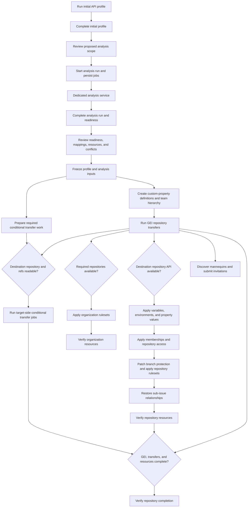

# GitHub-to-GitHub Migration Engineering Design

Status: Draft

This document defines the complete GitHub-to-GitHub migration workflow for the
dashboard: source discovery, repository readiness, GitHub Enterprise Importer
(GEI), Git LFS transfer, API-restorable configuration, identity and mannequin
handling, recovery, and target verification. These are coordinated parts of one
migration, not separate product modes.

## Scope

The design covers:

- Git and metadata readiness evidence collected before migration
- GEI orchestration and progress monitoring
- Git LFS pointer evidence during profiling and conditional payload transfer
  during migration
- Configuration whose current state can be read from the source and written to
  the target through supported GitHub REST or GraphQL APIs:

  - Actions variables at organization, repository, and environment scope
  - Repository environments, excluding secrets
  - Organization custom-property definitions and repository values
  - Teams, parent relationships, memberships, and member roles
  - Direct and team repository access
  - Organization and repository rulesets
  - Branch-protection fields omitted by GEI
  - Sub-issue relationships and ordering
- Identity mapping, mannequin discovery, attribution invitations, and status

API recreation of secrets, Projects, Discussions, packages, runners, and other
gaps without a complete supported read/write path is outside the first
automated scope. GEI-owned data, including supported release history, remains in
scope for readiness, orchestration, and verification.

## Goals

- Produce evidence-based readiness without treating unreadable state as absent.
- Coordinate GEI, LFS, API-restorable resources, and attribution in the existing
  profile, migration, and batch workflows.
- Build one complete profile in two passes: broad API collection followed by
  selective deep repository analysis.
- Require explicit mappings for users, teams, repositories, and other target
  objects whose IDs change.
- Make target conflicts visible before writes occur.
- Resume each migration activity safely after process interruption.
- Retry failed LFS or API operations without repeating a successful GEI import.
- Verify the target through GitHub APIs and tool-specific reconciliation.
- Distinguish GEI transfer completion from completion of the whole migration.

## Non-goals

- Preserving source object IDs or historical timestamps
- Migrating secret values
- Creating or provisioning target user accounts
- Treating mannequins as organization members or access-control identities
- Guessing the result of an interrupted remote write
- Silently replacing target configuration
- Estimating exact GEI Git or metadata archive bytes from repository API counts
- Treating repository readiness, LFS, or API-restorable resources as separate
  user-facing migration products

## Existing System

The dashboard already provides the necessary outer workflow:

1. `POST /api/profile` inventories a source organization.
2. `GET /api/profile/:id` returns readiness and repository findings.
3. `POST /api/migrate` or `POST /api/migrate/batches` starts migration work.
4. The migration manager persists and schedules repository executors.
5. Source and target Octokit clients provide REST and GraphQL access.
6. Migration events provide durable replay for the UI.

Important current-state constraints are:

- `src/lib/server/profile/collection/signals.ts` checks only
  `HEAD:.gitattributes` at the repository root for `filter=lfs`; unreadable and
  absent currently collapse to the same Boolean result.
- `src/lib/server/profile/analysis/duration.ts` estimates duration only from the
  repository API `size` field.
- `src/lib/server/profile/analysis/repos.ts` intentionally leaves
  `git-sizer`-dependent findings indeterminate because no local analysis runs.
- `src/lib/server/migrate/github/monitor.ts` infers `IMPORTING_METADATA` from
  target repository visibility and counts; GitHub does not return that phase as
  an authoritative remote substate.
- `src/lib/server/migrate/executors/archive-to-ghec.ts` currently treats GEI
  success as whole-migration success.
- `src/lib/server/migrate/manager.ts` creates batch repository migrations
  incrementally; batch membership is durable, but there is no durable
  multi-track batch coordinator.
- `src/lib/server/migrate/executors/github-to-ghec.ts` performs source archival
  after GEI and `post_migration`; target behavior must defer destructive source
  finalization until required LFS, resource, and verification work completes.
- Migration events are durable SSE replay, but the existing schema has no
  analysis, LFS, API resource, mapping, or mannequin job tables.
- The production image does not contain Git, Git LFS, or `git-sizer`.
- `src/lib/server/migrate/exporters/docker.ts` already demonstrates the
  repository's sandboxed external-tool execution pattern.

The design extends these existing boundaries rather than creating another
GitHub client abstraction. `createClients` already supplies source and target
REST, GraphQL, and refreshable credential access.

### Current and target behavior

This is a target-state engineering design. The `Existing System` section is the
implemented baseline as of 2026-08-30; later sections define planned behavior
unless they explicitly say that behavior exists today. In particular, deep
analysis, LFS execution, complete resource snapshots, target resource writes,
mapping revisions, conflict decisions, multi-track completion, and mannequin
jobs are not implemented yet.

The existing detector emits a `git-archive-size-limit` estimate when API
`diskUsageKb` reaches 2 GiB. That is a current triage threshold, not proof of
archive size and not a substitute for the source/target-specific GEI limit.
Until deep analysis exists, findings that require local object data remain
indeterminate.

## GEI Coverage and Gaps

GEI remains responsible for the data it natively migrates. For a repository
migration, documented coverage includes Git source and commit history, pull
requests, issues, milestones, commit comments, workflows, topics, selected
repository settings, user history for migrated data, attachments, and releases
up to 10 GiB per repository. Wikis migrate without wiki attachments. Active
webhooks may migrate but must be re-enabled. Organization migration additionally
creates teams and team repository access, but not team membership.

The dashboard must not duplicate GEI-owned records through REST or GraphQL.
Post-GEI API work is restricted to documented omissions or incomplete fields.

| Gap | Disposition |
|---|---|
| Git LFS objects | Transfer with the staged LFS workflow; do not model as an API resource |
| Actions variables | Capture and recreate through REST; values are configuration, not secrets |
| Actions environments | Recreate supported environment configuration; exclude environment secrets |
| Custom properties | Recreate organization definitions and repository values through REST |
| Teams and team membership | Adopt GEI-created teams when present or create mapped teams, then restore hierarchy, membership, and roles |
| Repository access | Restore direct and team grants after user, team, and repository mappings resolve |
| Rulesets and tag protection | Recreate as supported organization or repository rulesets |
| Partial branch protection | Patch only fields omitted by GEI; do not replace migrated fields blindly |
| Sub-issues | Restore parent, child, and ordering relationships after target issue IDs resolve |
| User attribution | Discover GEI-created mannequins and submit approved attribution invitations |

The following known omissions are not included in the first automated scope
because they are secret, lack a complete supported read/write path, require a
different migration mechanism, or cannot preserve the source semantics:
Actions, Codespaces, Dependabot, and webhook secrets; self-hosted and hosted
runners; workflow artifacts and run history; audit logs; code-scanning history;
commit status checks; Discussions; comment edit history; fork relationships;
GitHub Apps and installations; packages; Projects v2; stars and watchers; user
profiles and keys; secret-scanning remediation states; and links or references
whose reciprocal relationship is not recreated by GEI. Their profile findings
remain visible and route to an explicit manual, unsupported, or separately
tooled disposition rather than silently becoming success.

## Profile Generation

### Primary API pass

A GitHub profile captures both readiness signals and complete normalized source
records for the supported resources. Each resource reports one collection
state:

- `available`: collection completed and the snapshot may be used
- `empty`: collection completed and no records exist
- `forbidden`: the credential cannot read the resource
- `unsupported`: the source does not expose the required API
- `partial`: only part of the resource was collected
- `unknown`: the collector could not establish presence or absence
- `stale`: the snapshot is older than the allowed launch window

An authorization failure must never become an empty collection.

Profile also records separate Git, metadata, and identity workload evidence.
Repository API `size` is triage evidence only. It is not a measured GEI archive
size and must not by itself clear a repository for migration.

API collection records repository size, issues, pull requests, commits,
branches, tags, releases, known release assets, environments, rulesets, branch
protection, workflows, collaborators, webhooks, scanning, and other available
counts. Every value retains its collection state and capture time so zero means
an observed zero, not a failed request.

The current runner orders this work as `discovering`, `organization`,
`counting`, `details`, and `signals`. It then immediately builds the detail
rollup and completes the run. The target design preserves that primary pass but
does not make the expensive analysis part of the runner process.

## Repository Analysis Process

The primary API pass finishes first and marks its `profile_runs` record
`completed`. That completed profile is a stable initial assessment: it remains
readable, exportable, and comparable without waiting for clones or local Git
tools. It contains enough repository, metadata, file-tree, LFS-hint, and
identity evidence to propose the scope, checks, priority, and estimated
workspace demand of a deeper analysis.

Repository analysis is a separate, explicitly started process. The completed profile
page presents the proposed repository set and priority reasons. When an
operator starts it, one transaction creates a `profile_repository_analysis_runs` record
and its repository jobs from the completed profile. The profile is not reopened
or changed back to `running`. The dashboard does not clone repositories or wait
for analysis commands.

Target behavior: repositories selected for a repository analysis run receive a
local Git analysis. A dedicated profile analyzer claims durable repository jobs
and launches an isolated process for one repository at a time. Each job uses a
full, non-shallow Git mirror containing all reachable refs, then runs
`git-sizer --json --json-version=2` and `git lfs ls-files --all --json`. Today,
only the `HEAD:.gitattributes` hint exists; it is not proof that LFS pointers are
absent.

The analysis phase does not fetch Git LFS content, contact the target, or
schedule migration work. The Git mirror is analysis input because
`git-sizer` and historical pointer enumeration require a local object database;
LFS payloads remain external and are not downloaded during profiling.

### Routing criteria from the primary pass

The first-pass counts create typed follow-up jobs. They do not feed one blended
risk score, because a high issue count does not justify cloning Git objects and
a large Git repository does not justify paging every configuration API.

| First-pass evidence | Follow-up | Initial policy |
|---|---|---|
| Empty repository with observed size zero and no default branch | No Git-object analysis | Continue metadata, identity, and resource routing; empty repositories can still have configuration and access |
| Any selected, non-empty repository | Git-object analysis | Enqueue eventually; first-pass evidence determines priority, not whether local analysis occurs |
| API size is unknown, a prior migration failed for a Git-related reason, an unresolved finding needs local Git evidence, or an operator requests it | Highest analysis priority | Unknown or direct risk evidence takes precedence over proxy counts |
| Default-branch root LFS hint is present | Highest analysis priority | Enumerate historical pointers; this does not download LFS payloads |
| Default-branch root LFS hint is absent | No LFS-derived follow-up | Absence is not proof about history, but it must not send every repository to analysis; other Git triggers still apply |
| Default-branch root LFS hint could not be collected | Targeted collection retry and higher analysis priority | Preserve the read failure separately from an observed absence |
| API size at least 5 GiB | High analysis priority and expert review | GitHub recommends expert-led planning for complex repositories greater than around 5 GB; API size remains only a proxy |
| API size at least 1 GiB | Elevated analysis priority | GitHub describes less than 1 GB as ideal; this is a priority boundary, not a pass/fail limit |
| Branch count at least 5,000 | Elevated analysis priority | GitHub's repository-health guidance recommends no more than 5,000 branches |
| Higher default-branch commit, branch, or tag counts within this migration | Earlier analysis within the remaining queue | Use portfolio rank as a workload signal; there is no documented commit-count admission limit |
| Known metadata record floor at least 60,000 | Metadata expansion and review | Required; the public `gh-repo-stats` heuristic uses 60,000 composite records, but this is not a GEI hard limit |
| One or more issues or pull requests | Metadata expansion | Collect nested comments, reviews, events, and participating identities; higher counts affect queue priority |
| One or more releases | Release expansion | Page all release assets or retain `partial`; calculate known bytes and compare with the 10 GiB release limit and 40 GiB metadata limit |
| Commits, issues, pull requests, collaborators, team memberships, reviewers, or policy actors are present | Identity expansion | Collect distinct source identities and evidence needed for target mappings and mannequin planning |
| Count greater than zero for an API-restorable resource | Full resource capture | Persist complete normalized records, not another count |
| Resource count or permission-sensitive signal is `unknown`, `forbidden`, or `partial` | Targeted collection retry or blocker | Never route unreadable state as empty |
| Count is an observed zero | No detail job for that resource kind | Retain the observed-zero evidence in the completed profile |

The known metadata record floor sums only observed records available at that
point, such as issues, pull requests, releases, milestones, comments, reviews,
events, collaborators, protections, and projects. Missing dimensions do not
contribute zero; they lower confidence and can independently require expansion.
The 60,000-record rule is a prioritization and review heuristic, not a metadata
byte estimate.

GitHub's migration-planning guidance says a complete inventory needs the
largest-blob and total-blob measurements from `git-sizer` for each repository
and recommends a dry run for every repository. A small API size or low commit
count cannot clear a repository: pathological tree structure and historical
large blobs may not be visible in the first-pass proxies. Consequently, all
selected non-empty repositories enter the durable analysis queue. API
`diskUsageKb`, default-branch commit count, and ref counts only control ordering.

The LFS hint therefore needs a collection state separate from its value:
`observed_present`, `observed_absent`, or `unavailable`. The current Boolean
`usesLfs` collapses an unavailable `HEAD:.gitattributes` response into `false`;
the primary-pass contract must stop doing that before this routing policy is
implemented. Historical LFS remains unknown until a queued analysis completes.

The size and branch priority bands come from published GitHub guidance. The
60,000-record rule comes from the public `gh-repo-stats` operational heuristic.
`git-sizer` uses 500,000 commits and 25,000 refs as one-star reference values,
but those are post-clone levels of concern, not suitable points at which to
begin analysis. Store the policy version, source, and matched reasons on every
follow-up job. Benchmark data may change queue weighting without rewriting
historical profile decisions.

The analysis queue is ordered by evidence, not repository name: prior
Git-related failures, unresolved local-only findings, positive LFS hints, and
unknown-size cases first; then repositories above the 5 GiB, 1 GiB, or 5,000
branch priority boundaries; then the remaining non-empty repositories ordered
by portfolio rank across size, default-branch commits, branches, and tags.
Within a priority class, use the smallest estimated workspace first to improve
throughput without allowing large jobs to starve; an age boost eventually moves
waiting jobs ahead.

Archived, stale, and forked repositories are not automatically skipped. Their
status affects migration selection, but if selected they retain the same
readiness requirements. Only empty repositories or repositories outside the
migration selection omit local analysis. A queued repository retains
`unknown` for checks that require a local object database until analysis
finishes; absence of a first-pass warning is not a passing result.

### File-check matrix

The target primary pass adds one recursive Git Trees API request for the
default-branch tip. It records paths, object types, and blob sizes for early
findings and queue priority. The response is only complete when `truncated` is
false; GitHub limits a recursive tree response to 100,000 entries or 7 MB. The
Contents API is reserved for targeted files because a directory response stops
at 1,000 entries and file content is unsupported above 100 MB.

| Check | Primary API evidence | Secondary analysis evidence | Profile result or action |
|---|---|---|---|
| Current default-branch blob sizes | Recursive tree blob sizes; `observed`, `truncated`, or `unavailable` | `git-sizer` maximum reachable blob plus object/path lookup across all refs | Greater than 50 MiB is an early repository-health warning; greater than 100 MiB raises migration review; a current blob greater than 400 MiB is already a GEI blocker, while analysis determines whether other refs or history contain more |
| Historical maximum blob | None; the default-branch tree cannot see prior versions or other refs | `git-sizer` maximum reachable blob | Greater than 100 MiB and at most 400 MiB is a warning/LFS candidate; greater than 400 MiB is a blocker |
| Total reachable blob bytes | Repository API size is a queue-cost proxy only | `git-sizer` total unique reachable blob size | Review near 40 GiB; block at or above 40 GiB pending authoritative archive review |
| Mirror on-disk size | No equivalent API measurement | Size of the completed mirror workspace | Greater than 10 GB is a repository-health and capacity warning, not the GEI source-size measurement |
| Tree completeness | Recursive response and `truncated` flag | Complete reachable tree walk | A truncated or unavailable API tree raises analysis priority and remains `partial`; it is never treated as a clean scan |
| Directory width and path depth | Compute for the default-branch tree only when the API response is complete | `git-sizer` maximum tree entries and path depth across reachable history | More than 3,000 entries in one directory or depth greater than 50 raises a GitHub repository-health warning |
| Checkout file count and bytes | Current default-branch floor when the tree response is complete | `git-sizer` maximum expanded blob count and bytes across reachable trees | Use `git-sizer` concern levels for operational review; there is no documented GEI pass threshold for these metrics |
| LFS configuration | Targeted `HEAD:.gitattributes` content; present, absent, or unavailable | Applicable `.gitattributes` rules and `git lfs ls-files --all --json` pointer inventory | Positive hint raises priority; historical pointers create required LFS migration work; absence at `HEAD` does not clear history |
| Submodules | Default-branch gitlink entries and targeted `HEAD:.gitmodules` content | Gitlinks and `.gitmodules` paths across reachable history | Inventory URLs and pinned commits; review destination reachability and credentials without cloning submodules during profiling |
| `CODEOWNERS` | Probe supported default-branch locations and retain the matched file SHA | Inspect the selected source revision used for migration planning | Parse user and team references into identity and team-mapping work; missing is observed absence, unreadable is unknown |
| GitHub Actions workflows | Current `HEAD:.github/workflows` names; the existing collector does this today | Parse workflow files from the selected source revision | Inventory referenced environments, variables, secrets, reusable workflows, and runner labels for post-migration work; never persist secret values |
| Symlinks, executable files, and unusual paths | Types, modes, and paths from a complete default-branch tree | Reachable-history and maximum-checkout metrics from the mirror | Preserve inventory and raise portability review for unsafe or unsupported path findings; do not dereference symlinks during profiling |

Every API-derived file check stores `observed`, `partial`, `truncated`,
`forbidden`, or `unavailable`, the analyzed commit SHA, and capture time. A
positive current-tree finding may raise priority immediately. A negative result
only describes that commit and never replaces the all-reachable-history result.

For each selected repository, analysis creates evidence owned by its
analysis run; it does not overwrite the completed initial profile. When all
required jobs are terminal, a finalizer computes repository readiness,
blockers, warnings, and the analysis rollup, then marks the analysis run
`completed`. Analysis failure is retained on that repository and does not
erase the primary API findings.

A repository analysis failure normally finalizes as `unknown` evidence and a
blocked result for that repository. The analysis run becomes `failed` only when its jobs or
finalization cannot produce a coherent result. The initial profile remains
`completed`.

`profile_runs` keeps the existing `running`, `completed`, and `failed` states.
`profile_repository_analysis_runs` independently uses `queued`, `running`, `finalizing`,
`completed`, `failed`, or `cancelled`. A retry creates another attempt on the
same repository job. A later refresh against changed source refs creates a new
analysis run; it does not mutate or version the completed run.

API collection and deep analysis have independent capacity pools. A profile
finishes and releases the provider's API-crawl slot before analysis can be
started. Analysis workers enforce global concurrency, disk quota, and
per-host limits across all analysis runs.

The completed profile calculates two storage estimates from API `diskUsageKb`:
cumulative clone I/O across the selected repositories and peak workspace for
the repositories that may run concurrently. For admission, each known-size
repository reserves twice its API size plus 1 GiB of command and filesystem
overhead. The run estimate is a range and is labeled provisional because the
API cannot expose the packed all-ref mirror size, unreachable-object behavior,
or historical LFS payload size. LFS payloads are excluded because analysis does
not download them.

Before claiming work, the scheduler reads actual `/analysis` capacity and free
space. It preserves a host reserve of the greater of 5 GiB or 10 percent of
filesystem capacity, then admits a job only when its reservation fits above
that reserve and any already claimed reservations. A deployment may set a
lower operational ceiling without changing the profile estimate. A repository
with unknown API size is admitted one at a time only when the host is otherwise
idle; the worker monitors workspace growth and fails the attempt as
`insufficient_workspace` before consuming the host reserve. Measured mirror
sizes feed later estimates but never rewrite historical runs. The API size is
an admission proxy, never readiness evidence. The claim transaction is short;
cloning and tool execution occur outside SQLite transactions.

Each analysis job is independently claimable and records `queued`, `running`,
`succeeded`, `failed`, or `cancelled`; attempt count; lease owner and expiry;
source ref fingerprint; workspace allocation; tool versions; normalized result;
and failure evidence. Workers renew leases while active. An expired lease makes
the job claimable again after its isolated workspace is discarded or proven
safe to reuse.

The analysis service also owns a lightweight finalizer loop. After all
required jobs for an analysis run become terminal, one service instance
atomically claims finalization, computes repository findings and rollups, and
marks that analysis run `completed` or `failed`. Expensive repository
commands never execute in the dashboard/API process.

The analysis service has its own deployment and image. That image contains
Bun, Git, Git LFS, and pinned `git-sizer`; the dashboard image does not gain
those tools. Each service process claims at most one repository at a time and
runs its commands in a dedicated workspace under deployment-level CPU, memory,
PID, duration, output, and storage controls. Additional worker processes may
share the SQLite queue only on the same host and local volume. Multi-host workers
require replacing SQLite queue coordination and are outside this design.

The service receives the same server-owned source authentication configuration
as the dashboard and creates fresh source clients or Git credentials per job.
GitHub App installation auth is preferred because the service can refresh it;
an environment PAT is also recoverable. Request-scoped PATs or private keys are
not persisted or forwarded into the durable queue, so a profile requiring those
credentials cannot enter secondary analysis.

The current in-memory profile event publisher cannot carry progress from a
separate process. The analysis event endpoint must poll durable analysis
run and job aggregates and emit changes. The existing profile event endpoint
remains responsible only for the initial API pass. The database, not SSE
delivery, determines analysis progress and completion.

The normalized analysis result records:

- State: `pending`, `running`, `succeeded`, `failed`, or `unknown`
- Capture time, source ref fingerprint, default-branch tip, and analyzed ref
  tips
- Pinned Git, Git LFS, and `git-sizer` versions and the raw `git-sizer` JSON v2
  artifact
- Reachable commit, tree, blob, tag, and ref counts and sizes
- Total reachable blob bytes and maximum blob bytes, plus the blob object ID and
  a representative path when available from `git-sizer` naming output or a
  companion object scan
- Maximum tree entries, path depth and length, checkout path count and size,
  and other `git-sizer` concern metrics
- LFS pointer count, unique OIDs, paths, and declared bytes when available
- Derived blockers, review items, operational warnings, and supporting evidence

`git lfs ls-files --all` inventories LFS pointer history. It does not prove that
the corresponding source objects exist or are downloadable. That distinction
is enough for profiling: pointer presence creates required LFS migration work.
Source-object acquisition and integrity reconciliation happen later in the
migration workflow. `git lfs fsck` checks HEAD by default and is not used as a
profile-wide completeness guarantee.

`git-sizer` includes distinct objects reachable from refs. It excludes
unreachable objects and objects reachable only from reflogs. Its object sizes
are uncompressed, and checkout metrics describe the largest expanded tree rather
than archive bytes.

Analysis uses these readiness rules:

| Evidence | Classification | Required action |
|---|---|---|
| Maximum reachable blob greater than 400 MiB, measured by `git-sizer` | GitHub hard-limit blocker | Remove or rewrite the object before GEI |
| Maximum reachable blob greater than 100 MiB and at most 400 MiB | Warning and LFS candidate | Review history rewrite or LFS conversion; do not describe it as a GEI blocker |
| One or more LFS pointers | Required migration work | Add LFS transfer to the migration plan; do not download payloads during profiling |
| Total reachable blob size at or above 40 GiB | Launch blocker pending review | Treat as over-limit evidence until GitHub validates the actual GEI archive or an exception |
| Total reachable blob size within a configurable review band below 40 GiB | Review | Escalate because uncompressed reachable blobs are not the exact compressed GEI archive |
| Pathological object, tree, checkout, path, or ref counts | Operational warning | Review clone, export, import, storage, and timeout risk |
| Required local analysis failed or is stale | Unknown and launch blocker | Retry or obtain an explicit reviewed exception |

The near-limit review boundary is configuration and must remain distinct from
GitHub's 40 GiB limit. `git-sizer` measures reachable, uncompressed Git objects;
it does not calculate the compressed archive submitted to GEI. Its total blob
size is therefore evidence for review, not a substitute for an authoritative
GEI archive measurement.

The dedicated analysis service follows the existing Docker exporter controls.
Its image pins Git, Git LFS, and `git-sizer`; receives short-lived source
credentials without placing them in arguments or logs; and uses bounded CPU,
memory, process, disk, output, duration, and concurrency limits. Mirrors are
cleaned after analysis by default. Reuse requires a matching ref fingerprint,
credential-safe storage, an explicit retention policy, and a fetch that proves
the mirror is current.

### Analysis result

Analysis is repository-wide and LFS is only one output. The result combines:

- Git size and shape: commits, trees, blobs, refs, maximum objects, history
  depth, checkout expansion, and path metrics
- GEI limit evidence: maximum blob size and total reachable blob size
- Operational risk: pathological object, tree, checkout, or ref counts
- LFS pointers: presence, OIDs, paths, and declared sizes from pointer records
- Evidence identity: source ref fingerprint, tool versions, capture time, raw
  artifacts, and collection status

The enriched repository analysis produces the final readiness findings consumed
by profile views and migration planning. LFS does not define the analysis
state machine.

For LFS specifically, today the profile stores only the root
`HEAD:.gitattributes` proxy as `usesLfs`. The secondary pass replaces that
ambiguous Boolean with profile evidence:

- `unknown`: discovery could not establish LFS state
- `configuration_detected`: an applicable `.gitattributes` rule was found, but
  no pointer has yet been proven
- `pointers_detected`: pointer OIDs were inventoried from Git history

Source-object acquisition and target reconciliation are not profile evidence;
they belong to conditional migration jobs.

## Workload and Duration

`git-sizer` cannot measure GEI metadata. Profile therefore records a separate,
API-derived workload with collection state and capture time for every metric:

- Issues, pull requests, milestones, reviews, review comments, issue comments,
  issue events, and commit comments
- Releases, release assets, known release-asset bytes, and other measurable
  attachments
- Discussions and other migrated records when the source API exposes complete
  counts
- Unique contributing users, commit authors and committers, and identities
  referenced by migrated metadata
- Unmapped, ambiguous, and target-ineligible identities that may become
  mannequins or block access restoration

Commit count is part of Git traversal and transfer workload, not metadata
archive bytes. Contributor and committer cardinality also feeds the identity
and mannequin workload. Counts are retained as dimensions rather than summed
as if each record had equal cost.

The duration estimator combines calibrated Git, metadata, and identity bands.
Git evidence includes repository bytes, commits, refs, and structural concern
metrics. Metadata evidence includes issue and pull-request volume, comments,
reviews, events, releases, and known attachment bytes. Identity evidence
includes distinct contributors and unresolved mappings. Estimates expose the
dominant factors and confidence instead of returning a size-only duration.

GitHub states that migration duration is driven largely by pull-request and
issue counts and the number of contributing users. Commit count remains a Git
traversal input; commit author and committer cardinality remains an identity and
attribution input. Neither is mislabeled as metadata archive bytes.

GitHub defines metadata for the 40 GiB limit as issues, pull requests, releases,
and attachments. API counts and known release-asset bytes can identify high
risk and provide a lower bound, but they cannot prove the serialized metadata
archive size. The profile reports the hard-limit status as `within_limit`,
`review`, `blocked`, or `unknown`. Only authoritative archive evidence may mark
the byte limit `within_limit`. A measurable lower bound at or above 40 GiB, such
as known release assets alone, is sufficient to block; otherwise large record
counts, many users, or large known attachments produce `review`, not a
fabricated byte total. Release assets approaching or exceeding GEI's separate
10 GiB per-repository release limit require review of `--skip-releases` and a
separate release transfer plan.

The initial implementation should retain raw dimensions and produce separate
Git, metadata, and identity bands with confidence. It must not invent a single
weighted score before observed migrations provide calibration data. Duration
estimates include the dominant factors, evidence age, missing dimensions, and
the assumed repository concurrency.

## Operator Workflow

### 1. Configure

The existing migration setup adds resource selection and mapping to the plan.
Readable resources default to selected. An unavailable resource cannot be
selected until access is corrected; the operator may explicitly exclude it.

The operator reviews:

- Source repositories and target names
- Selected resources
- Source-user to target-user mappings
- Source-team to new or existing target-team mappings
- Target conflicts and the chosen action for each conflict
- Exclusions and expected external waits

User mappings are required before launch for memberships, repository access,
environment reviewers, and policy actors. Mannequin IDs do not exist until GEI
creates them on the target, but later attribution uses the same approved user
mapping.

### 2. Run

The batch view shows one overall migration and separates repository transfer
from resource work. Repository rows show transfer, settings, access,
relationships, and verification. Organization work appears once above the
repository rows.

### 3. Attribute

After GEI creates mannequins, the dashboard discovers them on the target,
matches them to the approved identity map, and submits attribution invitations.
The dashboard records GitHub's documented states: `Invited`, `Completed`, and
`Rejected`.

For ordinary accounts, acceptance happens outside the dashboard. The public
GraphQL mutation currently exposes only `ownerId`, `sourceId`, and `targetId`.
Immediate Enterprise Managed User attribution must not be promised until its
supported API behavior is validated. Retry, cancellation, and replacement of a
rejected invitation are also undocumented and remain operator blockers.

### 4. Verify

The dashboard reads target state, normalizes it, and compares it with the frozen
source snapshot. Verification reports exact matches, accepted differences,
failures, and resources excluded by the operator.

## Completion Semantics

Today, the executor marks the migration `succeeded` when GEI reports
`SUCCEEDED`. In the target design, GEI `SUCCEEDED` means that the repository
transfer completed; it is a milestone, not the terminal state of the whole
migration.

A repository is launchable when:

- required API collections are complete and current;
- required local analysis is complete and matches the approved source ref
  fingerprint;
- no reachable blob exceeds 400 MiB;
- near-limit or over-limit Git evidence has the required review outcome;
- every discovered LFS pointer is represented by required migration work; and
- mappings, exclusions, and target conflict decisions are approved.

A repository migration succeeds when:

- GEI succeeded;
- required LFS objects were synchronized and verified when pointers were found;
- every selected repository-scoped resource was applied or explicitly skipped;
- every required repository-scoped resource passed verification; and
- no write has an unknown remote outcome.

A batch succeeds when every required repository and selected organization
resource passes verification. A failed security, access, Git, or LFS operation
prevents success. An operator exclusion is recorded as `skipped`, never as
success.

Pending mannequin acceptance is visible at batch scope and does not occupy a
repository execution slot. Product state must distinguish a verified migration
from one still waiting for attribution. Transfer, LFS, API resources,
verification, and attribution remain separate status axes even when the UI
summarizes them into one overall result.

The existing top-level states remain `queued`, `pending`, `running`,
`cancelling`, `succeeded`, `failed`, `cancelled`, and
`reconciliation_required`. Track-specific jobs supply detail rather than a
second competing migration state machine. In the target design, `succeeded` is
set only after all required track barriers pass.

Destructive source finalization is downstream of target verification. Source
archival or locking must not begin merely because GEI succeeded; it waits until
required LFS and API work is verified, reconciliation-required outcomes are
resolved, and the operator's source-retention policy permits the action.

## Source Snapshots

A profile result is useful for selection, but it is not sufficient execution
state. At launch, the application must freeze the selected normalized records
inside the migration domain. This prevents profile retention, later source
changes, or collector changes from altering a running plan.

Every frozen item contains:

- Snapshot version and content hash
- Resource kind and scope
- Stable source key
- Source organization and optional repository
- Normalized desired state
- Collection state and evidence
- Capture time

Credentials, tokens, and secret values are never stored in snapshots.

## Identity and Target Mappings

Mappings use stable source identities and retain resolved target IDs because
GraphQL node IDs, database IDs, repository IDs, team IDs, field IDs, and ruleset
IDs cannot be reused across organizations.

Required mappings include:

- Source user login or ID to target login and ID
- Source team ID and slug to target team ID and slug
- Source repository ID and name to target repository ID and name
- Source ruleset ID to target ruleset ID
- Source issue ID to target issue ID for sub-issues
- Target mannequin ID to the approved target user

Mappings are versioned. A running plan points to an approved revision so later
mapping edits cannot silently change already planned work.

Mannequin attribution and access restoration remain separate. Reclaiming a
mannequin does not add a user to the organization, a team, or a repository.
Git commit attribution remains email-based. The identity inventory still records
commit authors and committers because they affect attribution expectations and
the number of people who may require mapping or mannequin reclamation.

## Conflict Policy

Before launch, the application compares source desired state with current target
state. Each item is classified as:

- `create`: target item is absent
- `adopt`: target item is equivalent after normalization
- `update`: operator approved replacing the relevant target fields
- `keep`: operator approved retaining different target state
- `blocked`: no safe or approved action exists

There is no global last-write-wins rule. Source and target timestamps do not
define ownership. The default for differing target state is `blocked` until the
operator chooses `update`, `keep`, or an existing target mapping.

Apply operations must update only fields owned by the plan. In particular,
branch protection updates only the fields GEI omitted rather than replacing the
entire rule.

## Execution Order

Migration execution starts only after the initial profile and selected
analysis run are complete and their approved evidence, repository mappings,
frozen snapshots, identity mappings, conflict decisions, and initial jobs are
committed together.

The diagram is target architecture. The current GitHub-to-GHEC executor runs
preflight, source or archive preparation where applicable, GEI start and
monitor, post-migration source handling, and then terminates; it has none of the
new analysis, LFS, API resource, mapping, or verification jobs.



Dependency barriers are specific to each resource:

- Primary API collection and secondary deep analysis both complete before the
  profile can be approved for migration.
- Acquiring LFS payloads is conditional migration preparation, not profiling.
- Custom-property definitions and team hierarchy may be created before GEI.
- Repository variables, environments, property values, access, branch
  protection, and repository rulesets wait for that target repository.
- Team membership waits for target-user mapping; team repository grants also
  wait for the target repository.
- Organization variables that select repositories wait for target repository
  IDs.
- Organization rulesets wait until all repositories affected by those policies
  finish GEI so the rules cannot obstruct import.
- LFS synchronization starts as soon as the target refs are readable, normally
  while GEI is importing metadata. The inferred display phase can trigger a
  probe, but only the successful probe releases the LFS job.
- Sub-issues wait until every referenced target issue ID is known, including
  cross-repository relationships.
- Mannequin discovery waits for GEI and is deduplicated at target-organization
  scope.

The monitor may continue to display `EXPORTING`, `IMPORTING_GIT`, and
`IMPORTING_METADATA`, but inferred phases never authorize irreversible work on
their own. Durable jobs advance only when their concrete dependency probes or
persisted predecessor results pass.

## Conditional LFS Transfer

This path exists only for repositories whose completed profile contains
`pointers_detected`. It is not part of API resource capture and it does not run
during secondary analysis.

The migration freezes the profile's OID, path, and declared-size evidence, then
acquires source payloads with `git lfs fetch --all` and reconciles the local
object store against that frozen evidence. Missing or corrupt source objects
fail the conditional job without invalidating the historical profile result.

`gh-migrate-lfs sync` scans canonical objects in the local LFS object store,
negotiates every OID through the destination LFS Batch API, uploads only missing
objects, and performs a final reconciliation. It does not push commits,
branches, or tags. Reruns renegotiate with the destination and safely skip
objects already present. Production execution requires hash checking and final
reconciliation.

The tool requires an existing destination repository and refs. Target sync
therefore waits for a direct readability probe. The dashboard's inferred
`IMPORTING_METADATA` phase may trigger that probe but cannot satisfy it.
Overlapping target sync with active GEI remains feature-gated until credentialed
sandbox trials establish supportability; the fallback barrier is GEI
`SUCCEEDED`.

## API-Restorable Resources

This table contains the configuration and relationships that can be captured
and fully recreated through supported APIs. LFS is intentionally absent because
it is repository content transferred through Git LFS, not an API-restorable
configuration resource.

These capture, apply, and verify paths are target behavior. Current profiling
collects only reduced signals for some rows, and the migration executor does not
yet recreate or verify them.

| Resource | API surface | Capture | Apply | Verify |
|---|---|---|---|---|
| Actions variables | REST Actions variables | Name, value, scope, visibility, selected repositories | Create or update at organization, repository, or environment scope | Compare value and normalized visibility |
| Environments | REST deployment environments and Actions variables | Name, reviewers, timers, self-review setting, branch policy and variables | Create environment, remap reviewers, apply policies and variables | Compare normalized environment configuration |
| Custom properties | REST organization and repository custom properties | Organization definitions, defaults, allowed values and repository values | Create or update definitions, then assign repository values | Compare definitions and assignments |
| Teams | REST teams and memberships | Name, slug, description, privacy, parent, members and roles | Create or adopt mapped parents first, then members | Compare hierarchy and membership roles |
| Repository access | REST collaborators and team repository permissions | Direct collaborators, teams and permission level | Grant mapped target users and teams | Compare requested direct and team grants without confusing inherited access |
| Rulesets | REST organization and repository rules | Scope, target, enforcement, rules, conditions and bypass actors | Create or update after remapping actors and repositories | Compare normalized rules and conditions |
| Branch protection | REST branch protection | Existing rules and fields omitted by GEI | Patch only omitted fields on the GEI-created target rule | Compare only fields owned by the plan |
| Sub-issues | REST issue relationships | Parent, children and order | Add, remove or reprioritize after target issue IDs resolve | Compare parent and ordered children |
| Mannequins | GraphQL migrations schema | Target mannequin ID, source login/email, claimant | Submit `createAttributionInvitation` for an approved target member | Refresh claimant and documented invitation status |

## Durable State

Migration events remain the audit and SSE projection. They are not the source of
truth for scheduling or recovery.

The profile domain currently has `profile_runs`, `profile_repos`, and normalized
source inventory tables, but no analysis queue or results tables. The
migration domain currently has `migrations`, `events`, `ghes_import_jobs`, and
`migration_batch_items`, but no LFS, API resource, mapping, or mannequin job
tables. The remaining records in this section are target schema additions.

### Profile evidence

The profile domain owns API collection results, workload dimensions, collection
states, proposed analysis scope, and evidence timestamps. A separate
repository analysis run owns its selected repositories, jobs, raw tool artifacts,
normalized Git metrics, ref fingerprints, LFS pointer evidence, and final
findings. Neither owns downloaded LFS payloads or source/target reconciliation.
Failed or stale evidence remains explicit.

Target profile persistence adds:

- `profile_repository_analysis_runs` for the completed-profile input, selected scope,
  policy version, aggregate state, timestamps, and finalization ownership
- `profile_repository_analysis_jobs` for queueing, leases, attempts, resource allocation,
  state, and errors, keyed to an analysis run
- `profile_repository_analysis_results` for immutable normalized evidence and
  bounded raw artifact references keyed by analysis run, repository, and attempt
- `profile_repository_analysis_lfs_pointers` for one normalized OID, declared
  size, and representative path per analysis result; payload availability is
  not asserted during profiling

The finalizer writes analysis-owned repository decisions and its run rollup
in a transaction. Repository job executors only persist their own results; the
analysis finalizer never changes the completed initial profile.

### Batch plans

The migration domain owns a frozen copy of one completed profile and one
completed repository analysis run. One plan records both IDs, source-ref fingerprints,
workload evidence, LFS manifest hashes, selected resources, conflict policy,
mapping state, target organization, state, and timestamps.

### GEI jobs

The existing migration and GHES import records remain authoritative for GEI
submission, migration IDs, remote status, inferred display phase, attempts,
failure details, and repository transfer result.

### LFS jobs and manifests

Each repository with proven pointers has a source-acquisition result and a
target-sync job. Durable state includes the frozen OID/size manifest, source
object completeness, dependency barrier, tool version, attempts, bounded report
artifact, destination negotiation result, and reconciliation status. A local
mirror or object store is replaceable working data, not the job ledger.

### Resource jobs

A job represents one resource at organization or repository scope. It records
its dependency barrier, phase, attempts, last error, and terminal result.

Suggested job states:

- `pending`
- `blocked`
- `running`
- `waiting`
- `succeeded`
- `failed`
- `reconciliation_required`
- `skipped`

### Resource items

An item records the stable source key, target key, desired state, conflict
decision, idempotency key, apply result, and verification result. Item-level
state allows focused retry without replaying successful writes.

### Identity mappings

Mappings record source identity, target identity, mapping status, approval
revision, and attribution status. Team mappings are retained separately because
teams are both migration resources and access-control actors.

### Mannequin invitations

Invitation records retain the target mannequin ID, target user ID, submission
attempt, documented GitHub status, and last refresh time. Unknown outcomes enter
`reconciliation_required` rather than being resubmitted automatically.

Every authoritative state transition and its corresponding event are committed
in one SQLite transaction. Events may be rebuilt as a projection; jobs, items,
manifests, mappings, and invitations may not.

## API Contract

The existing profile and migration endpoints remain the top-level entry points.
Repository-analysis, LFS, resource, mapping, and mannequin routes below are planned API
extensions, not current routes.

### Profile

- `POST /api/profile` starts the initial API profile. The request returns the
  run while API collection continues; that run reaches a terminal state without
  starting repository analysis.
- `GET /api/profile/:id` includes collection completeness, initial findings,
  workload bands, proposed analysis scope and priority reasons, prior analysis
  runs, selected analysis results, and snapshot metadata.
- `GET /api/profile/:id/resources` pages through captured records by resource
  kind and repository without expanding the normal profile response.
- `POST /api/profile/:id/repository-analyses` validates that the profile is
  completed, accepts selected stable repository IDs, and creates an analysis
  run and its jobs atomically.
- `GET /api/profile/:id/repository-analyses/:analysisRunId` returns run progress,
  policy decisions, queue state, evidence age, normalized Git metrics, LFS
  evidence, readiness, and findings.
- `POST /api/profile/:id/repository-analyses/:analysisRunId/repositories/:repoId/retry`
  retries a failed job without repeating primary API collection.

### Migration creation

`POST /api/migrate` and `POST /api/migrate/batches` accept:

```json
{
  "profileRunId": "profile-id",
  "analysisRunId": "analysis-id",
  "resources": {
    "include": ["variables", "environments", "custom-properties"],
    "mappingSetId": "mapping-set-id"
  }
}
```

The server rejects launch unless both runs exist, the analysis belongs to the
profile, the analysis is completed, every selected repository has a current
terminal result, required conditional work is present, selected snapshots are
complete, mappings are resolved, and conflicts have decisions. Batch creation
freezes the profile snapshots and analysis results and persists all initial
work before launching the first repository.

### Migration status and commands

- `GET /api/migrate/:id` returns separate GEI, LFS, API resource, verification,
  and attribution summaries in addition to the overall state.
- `GET /api/migrate/batches/:id` aggregates the same tracks without hiding a
  blocked or reconciliation-required repository.
- `POST /api/migrate/:id/lfs/retry` retries source-safe or target-safe LFS work;
  destination sync always renegotiates the frozen manifest.
- `GET /api/migrate/:id/resources` returns repository job and item status.
- `GET /api/migrate/batches/:id/resources` returns organization jobs and the
  repository resource summary.
- `PUT /api/migrate/batches/:id/resources/mappings` validates and versions user
  and team mappings before execution.
- `POST /api/migrate/:id/resources/retry` retries selected failed repository
  items.
- `POST /api/migrate/batches/:id/resources/retry` retries selected failed
  organization items.
- `GET /api/migrate/batches/:id/mannequins` returns mapped and unmapped target
  mannequins and invitation state.
- `POST /api/migrate/batches/:id/mannequins/refresh` refreshes target state.
- `POST /api/migrate/batches/:id/mannequins/invitations` submits approved
  attribution invitations.

Every command updates authoritative state and appends its event in one database
transaction. Events then drive the existing SSE views.

## Frontend Impact

Repository analysis is a second backend process and a second step in the
workflow, but its output is profile data. The existing `/profile/:id` page owns
the complete experience. It first shows the completed API profile and proposed
analysis scope; after the operator starts analysis, the same page exposes its
progress and folds terminal results into repository readiness. Historical
analysis runs remain selectable for audit without becoming separate products.

| Surface | Current frontend | Target frontend | Required change |
|---|---|---|---|
| Profile state | One `running`, `completed`, or `failed` API run | API profile keeps its terminal state while a child repository analysis has its own lifecycle | Never change a completed API run back to running |
| Profile progress | One API percentage and transient phase | API progress ends normally; repository analysis reports from the repository toolbar and row states | Keep both lifecycles distinct without creating a second page section |
| Analysis handoff | None | Completed profile proposes repositories, check families, priorities, omissions, and workspace range | Add explicit selection and `Analyze repositories`; never enqueue mirrors implicitly |
| Readiness | Zero blockers can display as clear | API findings remain the baseline while Git analysis state enriches each repository independently | Repositories without blockers or warnings can remain ready without Git analysis |
| Repository worklist | API findings and count tiles | API evidence and deep Git analysis appear together for each repository | Preserve evidence source, capture time, and analysis run identity |
| Live updates | In-process API SSE | Durable analysis aggregates refresh the visible profile view | Preserve filters, expanded repository, and selection during updates |
| Planning | Available after API completion | Each repository is eligible independently; a GitHub repository with blockers or warnings requires its own successful Git analysis | Revalidate every selected repository when creating the batch |

### Profile repository enrichment

Repository analysis is not a separate frontend destination. The analyzer is a
separate backend process because Git work is expensive, but its output enriches
the repositories already owned by the profile. The repository worklist remains
the dominant composition.

The existing Repositories section owns the analysis control, aggregate status,
and results:

```text
Repositories (140)                         [Readiness v] [Filter repositories]

Git data not analyzed
Add mirror size and historical LFS data to each repository. [Analyze Git data]

Repository        Severity     Git analysis       Migration findings
payments-api      clear        Not analyzed       -
monolith          warning      Not analyzed       Large release assets
```

Starting analysis creates one child `profile_repository_analysis_runs` record
plus one job for each selected non-empty repository. The compact repository
toolbar reports aggregate progress and cancellation; each existing repository
row reports queued, running, analyzed, failed, or cancelled. Empty repositories
show that analysis is not required. A cancelled run never renders cancelled jobs
as completed progress.

Successful rows show mirror size in the table. Their existing disclosure adds
normalized Git and LFS measurements alongside the API-derived repository facts.
Failed rows expose their failure reason in that same disclosure. Raw command
output and worker controls never appear in the UI.

A successful repository job contributes its normalized Git metrics, LFS pointer
inventory, fingerprints, findings, and readiness to the profile read model. It
does not overwrite API snapshots or gate unrelated repositories. A later
analysis run creates new child records. Changed source refs mark affected
results stale and require a new analysis run.

At widths below 640 px, repository filters and the analysis toolbar stack before
the existing horizontally scrollable worklist. Full action labels remain
visible. Repository disclosures retain Git/LFS facts and failure reasons.

The existing `src/routes/profile/[id]/+page.svelte` remains the composition
owner. Route-local production components are:

```text
Header.svelte                         # API profile and selected analysis states
RepositoryAnalysis.svelte            # compact repository toolbar and run controls
RepoTable.svelte                      # API facts plus per-repository Git/LFS results
MigrationPlanDock.svelte             # analysis-bound eligibility and handoff
live.svelte.ts                        # API and analysis SSE hints
planner.svelte.ts                     # analysis-bound selection and target names
```

`Pagination`, `Octicon`, and confirmation dialogs remain shared components.
The style guide imports these production components with deterministic fixtures
after they exist; it does not maintain an imitation.

Acceptance criteria:

- In the Repositories section, an operator can distinguish API profile facts
  from Git analysis state and identify the next action.
- API completeness, analysis lifecycle, readiness, and finding severity remain
  visually and semantically distinct.
- Starting or retrying analysis never changes the terminal API profile state.
- Filters, expanded details, and selected analysis survive live updates.
- Running, queued, failed, stale, unknown, ready, warning, and blocked states
  have deterministic fixtures and tested behavior.
- There is no page-level overflow, clipped control label, nested card, or
  required text below 13 px at 1440 px, 1024 px, and 390 px.

## Implementation Readiness

There is enough design and repository evidence to begin implementation, but not
to enable the complete GitHub-to-GitHub feature in production as one release.
Implementation proceeds behind resource capability flags and the rule that a
construct is selectable only after its read, freeze, apply, recovery, and
verification paths pass credentialed tests.

The repository-analysis foundation decisions below are accepted as the initial
contract. They may be calibrated later without weakening historical evidence
or changing migration inputs silently:

| Decision | Recommended default | Why it must be fixed first |
|---|---|---|
| Active child runs | Allow one nonterminal analysis per profile; a duplicate start returns that run | Prevent duplicate mirrors and define POST idempotency |
| Repository scope | Preselect every non-empty repository; allow exclusions, but excluded repositories remain ineligible for migration from that analysis | Preserve complete Git readiness while allowing an intentionally bounded run |
| Partial failure | Mark the analysis `completed` when all jobs are terminal; failed repositories remain `unknown` and blocked. Reserve run `failed` for an invalid rollup or unrecoverable process failure | Determines terminal-state constraints and profile rendering |
| Selected analysis | Show the active run while one exists, otherwise the newest completed run; allow `analysisRunId` to select history. Migration always sends an explicit completed ID | Prevent a later run from silently changing a reviewed migration input |
| Cancellation | Cancel queued jobs immediately and signal an active job; keep terminal results and mark the run `cancelled` after active work stops | The state already includes `cancelled`, so its command and recovery semantics must exist |
| Workspace admission | Start with one active repository per analyzer, a six-hour job timeout, bounded command output, profile-derived workspace estimates, and runtime filesystem admission. Preserve the greater of 5 GiB or 10 percent free; an optional deployment ceiling may further restrict use | A clone can exceed its API size proxy, so admission and live growth checks protect the shared volume |
| Durable artifacts | Delete mirrors after every terminal attempt. Persist normalized metrics; store LFS pointers as normalized child rows, not one JSON result. Retain only bounded, redacted raw tool output under profile retention | LFS inventories can be large, and raw output is neither a scheduler ledger nor safe unbounded SQLite data |
| Toolchain | Pin exact Git, Git LFS, and `git-sizer` versions in the analyzer image and fixture their output schemas | Reproducibility and parser compatibility depend on concrete versions |

The existing authentication decision is already fixed: repository analysis is
available only with recoverable server-owned GitHub App or environment PAT
credentials. A profile created with request-only credentials remains readable,
but `Analyze repositories` is unavailable with an explicit reason.

| Area | Ready now | Must be decided or proven before production enablement |
|---|---|---|
| Profile and repository-analysis model | Child run states, snapshots, findings, readiness, and stable IDs are defined | Final acceptable snapshot age and evidence weighting |
| Repository analysis process | Separate process, durable leases, mirror lifecycle, commands, normalized results, and completion rules are defined | Measured concurrency, disk quota, timeout, and retention defaults on representative repositories |
| SvelteKit surface | Route ownership, load/action/API split, live refresh, responsive composition, component boundaries, and states are defined | Final operator copy after usability review; no architecture decision remains |
| LFS | Detection, frozen manifest, refs barrier, transfer, retry, and verification are defined | Credentialed proof against the pinned `gh-migrate-lfs` version and representative missing-object cases |
| API resources | Initial resource list, source/target ownership, dependencies, conflict records, and verification shape are defined | Per-resource source/target permissions, GitHub plan/version availability, exact endpoint schemas, and create/update/adopt behavior |
| Identity | Evidence, versioned mappings, mannequin invitations, and waiting states are defined | EMU behavior, rejected/repeated invitation semantics, and export format for users absent from the target |
| Batch handoff | Completed profile and analysis IDs plus the approved mapping set are frozen before migration work starts | Final immutable batch schema and organization-resource serialization across concurrent batches |
| Estimates | Workload dimensions and confidence bands are defined | Calibration from observed GitHub-to-GitHub runs; estimates remain labeled provisional until then |

The first implementation increment can include schema evolution,
collection-state fidelity, repository-analysis queue and worker, normalized
Git/LFS evidence, completed analysis runs, and the enriched repository worklist.
The second can add analysis-bound selection and frozen batch creation.
Each API-restorable resource then ships vertically behind its own capability
flag. Identity-dependent resources remain unavailable until mapping and
mannequin behavior is proven. This order produces a usable evidence product
without pretending unresolved target-write semantics are complete.

## Code Organization

The target extends the existing domain layout instead of creating a second
application tree. Code is organized first by domain (`profile` or `migrate`),
then by responsibility, then by resource scope where scope matters.

### Deployables and storage

One repository build produces two images from named Dockerfile targets:

| Compose service | Image name | Command | Owns | Mounted storage |
|---|---|---|---|---|
| `gh-migrate` | `gh-migrate` | `bun build/index.js` | SvelteKit UI/API, primary collection, planning, migration orchestration | `/data`, `/archives`, existing Docker socket |
| `profile-analyzer` | `gh-migrate-profile-analyzer` | `bun build/profile-analyzer.js` | Repository-analysis queue claims, mirrors, Git tools, leases, result persistence, and analysis-run finalization | Shared `/data`, private `/analysis`; no `/archives` or Docker socket |

```mermaid
flowchart LR
  Browser[Browser] --> Dashboard[gh-migrate UI and API]
  Dashboard --> ProfileStore[(profile tables in /data/gh-migrate.db)]
  Analyzer[profile-analyzer] --> ProfileStore
  Analyzer --> Workspaces[/analysis attempt workspaces]
  Dashboard --> MigrationStore[(migration tables in /data/gh-migrate.db)]
  Dashboard --> Archives[/archives migration exports]
  ProfileStore -->|completed profile + analysis run| StartBatch[start-profile-batch command]
  StartBatch --> MigrationStore
```

`/data/gh-migrate.db` remains the single durable SQLite database and uses WAL
for same-host process coordination. The named volume remains `gh-migrate-data`.
The analyzer gets a separate `gh-migrate-analysis-workspaces` volume mounted at
`/analysis`; each attempt uses
`/analysis/<analysisRunId>/<repoId>/<attempt>/`. Mirrors, credentials, and raw command
output are replaceable working data and are deleted after success or before a
retry. `/archives` remains migration-export storage and never holds profile
analysis mirrors.

The dashboard keeps the existing instance lock because it owns singleton UI
and migration orchestration. The analyzer does not run SvelteKit startup,
authentication bootstrap, migration recovery, or that instance lock. Its
bootstrap opens `/data/gh-migrate.db`, registers only `profileStore`, verifies
WAL mode and writable workspace capacity, then starts the claim loop. SQLite
queue transactions remain short; Git commands never run while a transaction is
open.

The root deployment files become:

```text
Dockerfile                         # `dashboard` and `profile-analyzer` targets
docker-compose.yml                 # both services and the two data volumes
entrypoint.sh                      # shared ownership drop; accepts either command
src/bin/profile-analyzer.ts        # boots only the repository-analysis claim loop
```

The `profile-analyzer` Docker target bundles `src/bin/profile-analyzer.ts` as
`build/profile-analyzer.js`; there is no host package script for analysis.
“Analyzer” names the deployable; “repository analysis” names the profile-owned
operation, records, and routes.

### Shared profile contracts

Browser-safe serialized types remain outside `$lib/server`:

```text
src/lib/profile/
  run.ts                           # initial ProfileRun state and rollup
  repository.ts                    # ProfileRepository and readiness values
  repository-analysis.ts           # jobs, metrics, findings, and summaries
  api-resource.ts                  # discriminated union of normalized API snapshots
  identity.ts                      # source actors and proposed/approved mappings
  migration-catalog.ts             # existing finding catalog
  migration-plan.ts                # existing selection and batch request contract
```

These modules contain data contracts and pure helpers only. They do not import
SQLite, Octokit, Svelte, filesystem APIs, or worker code.

### Profile server domain

Profile orchestration, local Git analysis, findings, and profile persistence
remain under `$lib/server/profile`. GitHub API readers are grouped by provider
and API scope, not under a generic `collection` or `resources` bucket:

```text
src/lib/server/profile/
  start-profile.ts                 # start/cancel a provider profile run
  read-profile.ts                  # list, detail, worklist, and repository read models
  run-github-profile.ts            # GitHub API profiling sequence and concurrency
  run-inventory-profile.ts         # GitLab/Bitbucket inventory profiling sequence
  events.ts                        # in-process hints; database remains authoritative

  github/
    organization/
      repositories.ts              # repository discovery and pagination
      rulesets.ts                   # organization rulesets
      actions-variables.ts
      custom-properties.ts
      teams.ts
    repository/
      indexed-counts.ts             # batched GraphQL issue/PR/release counts
      default-branch.ts             # commit proxy and branch metadata
      release-assets.ts
      workflow-files.ts
      file-tree.ts                  # recursive tree plus truncation state
      actions-variables.ts
      environments.ts
      repository-access.ts
      rulesets.ts
      branch-protection.ts
      sub-issues.ts
    identity/
      actors.ts                     # distinct metadata actors
      contributors.ts               # commit contributor attribution inputs

  repository-analysis/
    claim-loop.ts                   # priority, leases, retries, and concurrency
    analyze-repository.ts           # one claimed job from lease to terminal result
    clone-mirror.ts                 # credential-safe `git clone --mirror`
    measure-repository.ts           # pinned git-sizer command and JSON v2 normalization
    list-lfs-pointers.ts            # `git lfs ls-files --all --json`
    fingerprint-refs.ts             # analyzed ref-tip identity and staleness
    classify-findings.ts            # metrics to versioned findings
    finalize-analysis.ts            # readiness and rollup transaction

  analysis/
    classify-api-findings.ts        # API evidence to versioned findings
    readiness.ts                    # repository readiness decision
    rollup.ts                       # run-level readiness and workload aggregates

  database/
    schema.ts                       # all profile DDL remains one domain store
    runs.ts                         # initial API profile runs
    repositories.ts                 # summary, readiness, paging, and filtering
    repository-analysis-runs.ts     # selected scope, aggregate state, finalization lease
    repository-analysis-jobs.ts     # mutable queue, lease, attempt, and error state
    repository-analysis-results.ts  # immutable normalized attempt results
    api-resource-snapshots.ts       # immutable normalized GitHub API records
    identity-evidence.ts            # source actors and mapping inputs
```

Organization-scoped readers are never placed in the repository directory.
`github/organization` and `github/repository` modules accept an authenticated
GitHub client and return validated provider records; they do not write SQLite.
`run-github-profile.ts` normalizes and persists those results. Local Git
commands live only under `repository-analysis`.

The existing `runner.ts`, `inventory-runner.ts`, `service.ts`, and
`collection/*` modules migrate incrementally into this layout. New work does
not deepen those generic modules: `runner.ts` becomes
`run-github-profile.ts`, `service.ts` separates into start and read use cases,
and `collection/*` moves under the explicit `github` scope.

### Migration server domain

The migration domain consumes a completed profile plus a completed repository analysis
run and owns every target write. It does not import profile database modules:

```text
src/lib/server/migrate/
  lfs/
    find-source-objects.ts
    upload-objects.ts
    verify-objects.ts
  target/
    organization/
      actions-variables.ts
      custom-properties.ts
      teams.ts
      mannequins.ts
    repository/
      actions-variables.ts
      environments.ts
      repository-access.ts
      rulesets.ts
      branch-protection.ts
      sub-issues.ts
  runs/
    run-resource-plan.ts            # claims and dispatches persisted resource jobs
    run-lfs-plan.ts                 # claims and dispatches persisted LFS jobs
  database/
    resource-plans.ts
    resource-jobs.ts
    resource-items.ts
    lfs-jobs.ts
    lfs-manifests.ts
    identity-mappings.ts
    mannequin-invitations.ts
```

Source and target modules deliberately use matching scope and resource
basenames. For example, profile `github/repository/environments.ts` reads and
normalizes the source record, while migrate
`target/repository/environments.ts` applies and verifies it at the target.

The cross-domain command is
`src/lib/server/application/start-profile-batch.ts`, exporting
`startProfileBatch`. It loads the requested `profileRunId` and
`analysisRunId` through `read-profile.ts`, verifies that the analysis belongs
to the profile, validates readiness and the approved identity mapping
set, builds the immutable batch input, and calls the existing migration batch
manager. This is a command, not a new “plan” abstraction. Migration execution
receives the frozen input and never queries mutable `profile_*` tables directly.

### HTTP routes and frontend files

Routes stay thin and use numeric or UUID `repoId` values rather than embedding
the mutable `owner/name` display key in a path:

```text
src/routes/profile/[id]/
  +page.server.ts                  # load profile + selected analysis; actions
  +page.svelte                     # complete profile composition
  Header.svelte                    # API profile state
  RepositoryAnalysis.svelte       # repository analysis control and summary
  RepoTable.svelte                 # API facts and per-repository Git/LFS data
  Plan.svelte                      # analysis-bound migration handoff
  live.svelte.ts                   # API and repository-analysis SSE hints
  planner.svelte.ts                # analysis-bound selection and target names

src/routes/api/profile/[id]/
  events/+server.ts                # SSE for the initial API profile
  api-resources/+server.ts         # GET paged normalized API records
  repository-analyses/+server.ts   # GET history; POST starts a run
  repository-analyses/[analysisRunId]/
    +server.ts                      # GET progress and paged worklist
    events/+server.ts              # durable repository-analysis SSE
    repositories/[repoId]/
      +server.ts                    # GET detail; POST retries failed job
```

Reusable run-list and progress primitives remain in
`src/lib/components/profile`; repository worklist and planning components stay
route-local because they depend on the profile detail page contract. Raw tool
artifacts are never rendered inline. The detail endpoint returns normalized
metrics and bounded artifact metadata; downloading a retained artifact requires
an authenticated, audited route if retention is enabled later.

The browser workflow uses SvelteKit rather than a parallel client API layer:
`+page.server.ts` exports a typed `PageServerLoad` plus `startAnalysis`,
`retryRepository`, and `startMigrationBatch` actions. Forms use `use:enhance`
where preserving page state matters. `+server.ts` is reserved for SSE,
read-only JSON needed by live refresh, and explicitly supported external API
operations. Both transports call the same server command when an external
mutation endpoint is required.

Route modules import `PageServerLoad`, `Actions`, and `RequestHandler` from
their generated `./$types`. Command inputs are parsed once with a Zod schema
and TypeScript types are inferred from that schema. Values crossing from a
server load or action are plain serializable objects: IDs and ISO timestamps,
not database rows, clients, `Date` instances, or worker classes. Browser code
never imports `$lib/server`.

### Persistence names

Existing table names remain unchanged. Target profile additions are:

| Table or column | Ownership and purpose |
|---|---|
| `profile_repository_analysis_runs` | Profile-owned secondary process with `profile_run_id`, state, policy version, selected scope, aggregates, and finalization lease |
| `profile_repository_analysis_jobs` | One mutable queue record per analysis run and selected repository |
| `profile_repository_analysis_results` | Immutable normalized result per job attempt, including metrics and artifact metadata |
| `profile_repository_analysis_lfs_pointers` | Normalized historical LFS pointer OIDs, declared sizes, and representative paths keyed to an analysis result |
| `profile_resource_snapshots` | Immutable normalized API-resource records keyed by scope and source key |
| `profile_identity_evidence` | Distinct source identities and attribution evidence |

Migration additions retain the `migration_` prefix:

```text
migration_resource_plans
migration_resource_jobs
migration_resource_items
migration_lfs_jobs
migration_lfs_manifests
migration_identity_mappings
migration_mannequin_invitations
```

### Naming rules

- Database and JSON enum values use `snake_case`; TypeScript fields use
  `camelCase`; Svelte components use `PascalCase`; files use `kebab-case` except
  established component filenames.
- Use `profileRunId` for the completed initial API profile,
  `analysisRunId` for the separately executed child process, `repoId` for the
  stable `profile_repos.id`, `analysisJobId` for queue identity, and
  `attempt` for execution number. `nameWithOwner` is display and lookup data,
  never job identity.
- Use `organization` and `repository` in scope-bearing paths and serialized
  records. Do not abbreviate them to `org` or `repo` except established fields,
  IDs, and GitHub API terminology.
- Use `apiState` for API readability/completeness, `analysisState` for
  worker lifecycle, `readiness` for the final decision, and `severity` for an
  individual finding. These concepts must not share one `status` field.
- Use `snapshot` for immutable API capture, `analysisResult` for immutable local
  Git evidence, `job` for mutable execution state, `manifest` for frozen transfer
  input, and `mapping` for approved source-to-target identity.
- Every implementation file has a colocated `*.test.ts`; process integration
  tests live in `tests/integration/profile/repository-analysis.test.ts`, API flow tests
  remain under `src/routes/api/profile`, and browser behavior belongs in
  `tests/e2e/profile-repository-analysis.e2e.ts`.

Stable normalized contracts live outside the sibling server domains. The
application layer validates a completed profile and each selected repository's
eligibility, rejecting only GitHub repositories with findings that lack a
successful analysis job. Neither server domain imports the other.

The dashboard process owns API collection, planning, and status APIs. The
separate analyzer owns repository mirror creation, isolated tool processes,
leases, and analysis-run finalization. Both use the profile store contract; the
analyzer does not import routes or migration
orchestration.

The GitHub repository executor remains responsible for one repository. It
reports GEI completion to the coordinator and runs repository jobs whose
barriers are satisfied. The batch coordinator owns organization jobs,
cross-repository sub-issues, mannequin attribution, and final batch status.
Routes remain HTTP adapters and do not contain GitHub operations.

The migration never reads mutable profile analysis tables while it runs and
never reruns repository analysis implicitly. A changed source ref fingerprint
requires a new analysis run and operator approval.

## Recovery and Retry

Every planned write must define:

- A stable idempotency key
- A way to read target state before writing
- A normalized success condition
- Whether an interrupted write is safely repeatable

On restart:

1. Recover pending jobs using server-owned credentials.
2. Resume GEI monitoring from its persisted migration ID.
3. Leave analysis runs in `queued`, `running`, or `finalizing` recoverable;
  services reclaim expired job or finalization leases instead of changing the
  completed source profile.
4. Fail an interrupted initial profile because the current API crawl has no
  durable continuation point.
5. Recreate replaceable analysis or LFS working storage when necessary and
  verify it against the source ref or frozen manifest hash.
6. Renegotiate every frozen LFS OID with the destination; do not trust a local
  completion checkpoint.
7. Re-read target API state for interrupted resource items.
8. Mark work succeeded when its verified target condition is already present.
9. Retry only when the operation is known to be repeatable.
10. Mark ambiguous outcomes `reconciliation_required`.

Request-scoped credentials remain nonrecoverable under the current
architecture. Resource work using them fails with a clear restart requirement
instead of storing the credentials.

## Security

- Never persist PATs, App private keys, installation tokens, or secret values.
- Redact GitHub response bodies that may contain sensitive configuration.
- Treat teams, repository access, reviewers, bypass actors, and branch policy as
  security-sensitive work that must pass verification.
- Record the dashboard operator and approved conflict decision in the audit log.
- Require least-privilege source read and target write permissions for every
  selected resource.
- Preserve `forbidden` and `partial` collection states through planning and UI.
- Run Git, Git LFS, and `git-sizer` in the pinned analysis image, and
  `gh-migrate-lfs` in a separate pinned migration tool image. Both use a
  read-only root filesystem, dropped capabilities,
  no-new-privileges, bounded resources and output, and an isolated work volume.
- Pass short-lived credentials without command-line arguments, redact remote
  URLs and process output, and destroy working data according to retention
  policy.

## Testing

Each resource module requires:

- Source response parsing and pagination tests
- Normalization and target-diff tests
- Mapping and conflict tests
- Idempotent create, adopt, and update tests
- Authorization and rate-limit failure tests
- Interrupted-write reconciliation tests
- Verification tests

Profile-level tests require:

- Deep-analysis policy, threshold boundaries, ref fingerprinting, sandbox
  limits, malformed tool output, timeout, cleanup, and stale-result handling
- Durable analysis claiming, lease renewal and expiry, crash recovery,
  independent capacity pools, duplicate-worker exclusion, and finalization
- Cross-process analysis progress polling and completion after all required
  analysis jobs become terminal, without changing the initial profile state
- `git-sizer` fixture classification for maximum blobs, near-limit Git size,
  and pathological structures
- LFS configuration and pointer-history detection without downloading payloads
- Metadata and identity workload completeness, confidence, and duration-band
  tests that never convert record counts into unsupported archive bytes

Migration-level tests require:

- LFS pointer and missing-source-object detection plus refs-ready scheduling,
  idempotent synchronization, and target verification
- LFS configuration without pointers, pointer history without local objects,
  stale manifests, destination partial success, and reconciliation reruns
- Atomic batch-plan creation
- Dependency scheduling across organization and repository work
- Recovery from every durable checkpoint
- Resource-only retry without a second GEI migration
- Terminal-state rules for required failures and exclusions
- Mannequin invitation submission and status refresh
- Route authorization, validation, pagination, and audit tests
- End-to-end batch progress with organization and repository resources
- End-to-end status that keeps GEI, LFS, resources, verification, and
  attribution independently visible

Credentialed sandbox tests are required before enabling destructive GitHub API
operations in production. They must use disposable organizations and verify the
current FPT and GHEC behavior for every endpoint.

## Delivery Order

1. Preserve collection-state fidelity and add metadata and identity workload
  dimensions without changing migration launch behavior.
2. Add independently started analysis runs, a separate worker process,
  leases, capacity controls, Git readiness evidence, and analysis finalization.
3. Add frozen launch plans, durable multi-track jobs, completion axes, and
  recovery independent of SSE events.
4. Integrate `gh-migrate-lfs` source acquisition and refs-gated destination
  reconciliation.
5. Deliver Actions variables and custom properties end to end, including write,
   retry, and verification.
6. Add teams, memberships, repository access, and environments after identity
   mapping is operational.
7. Add omitted branch-protection fields and rulesets after policy conflict and
   actor mapping are proven.
8. Add sub-issues after durable issue-ID mappings are available.
9. Add mannequin discovery, invitation submission, refresh, and batch waiting
   states after the identity workflow is established.

A construct is not selectable in production until its capture, conflict,
apply, recovery, retry, and verification paths are all implemented.

## Research Sources

Research was last verified against public sources on 2026-08-30. Tool behavior
must be rechecked against the pinned release before implementation because the
supporting repositories can change independently of this dashboard.

- [GitHub migrations between products](https://docs.github.com/en/migrations/using-github-enterprise-importer/migrating-between-github-products/about-migrations-between-github-products)
  defines GEI coverage, omissions, release handling, and Git and metadata
  limits.
- [GitHub migration planning](https://docs.github.com/en/migrations/overview/planning-your-migration-to-github)
  directs a complete inventory to measure largest and total blobs with
  `git-sizer` for each repository and recommends a dry run for every repository.
- [GitHub repository limits](https://docs.github.com/en/repositories/creating-and-managing-repositories/repository-limits)
  provides the 10 GB on-disk and 5,000-branch repository-health guidance;
  [GitHub large-file guidance](https://docs.github.com/en/repositories/working-with-files/managing-large-files/about-large-files-on-github)
  describes less than 1 GB as ideal and less than 5 GB as strongly recommended.
- [Git Trees API](https://docs.github.com/en/rest/git/trees#get-a-tree)
  documents the recursive response's 100,000-entry and 7 MB limits and its
  `truncated` signal. [Repository Contents API](https://docs.github.com/en/rest/repos/contents#get-repository-content)
  documents the 1,000-entry directory limit and file-size behavior.
- [GitHub's current non-migrated-data source](https://raw.githubusercontent.com/github/docs/main/data/reusables/enterprise-migration-tool/data-not-migrated.md)
  provides the detailed omissions inventory.
- [GitHub's Git repository size-limit source](https://raw.githubusercontent.com/github/docs/main/data/reusables/enterprise-migration-tool/git-repo-size-limit.md)
  directs operators to inspect `git-sizer` total blob size.
- [`git-sizer`](https://github.com/github/git-sizer) documents full-clone
  requirements, reachable-object scope, uncompressed metrics, concern levels,
  and JSON output. Its source defines one-star reference values of 500,000
  commits and 25,000 refs; these describe results after analysis and are not
  pre-analysis admission thresholds.
- [`git lfs ls-files`](https://github.com/git-lfs/git-lfs/blob/main/docs/man/git-lfs-ls-files.adoc)
  and [`git lfs fsck`](https://github.com/git-lfs/git-lfs/blob/main/docs/man/git-lfs-fsck.adoc)
  define pointer inventory and integrity-check boundaries.
- [`gh-migrate-lfs`](https://github.com/mona-actions/gh-migrate-lfs), its
  [usage guide](https://github.com/mona-actions/gh-migrate-lfs/blob/main/docs/usage.md),
  and its [operations guide](https://github.com/mona-actions/gh-migrate-lfs/blob/main/docs/operations.md)
  define discovery, pull, direct sync, reconciliation, safety, and rerun
  behavior.
- [`gh-repo-stats`](https://github.com/mona-actions/gh-repo-stats) provides a
  useful public inventory model for metadata records and contributor counts;
  its historical thresholds remain tool heuristics, not GitHub limits.
- [GraphQL migration mutations](https://docs.github.com/en/graphql/reference/mutations#createattributioninvitation)
  provide the public mannequin attribution operation used by this design.

## Production Calibration Questions

- What concurrency, storage quota, and evidence weighting provide acceptable
  analysis latency across the actual repository-size distribution?
- If mirror reuse is considered after the first release, what retention period,
  storage quota, ref-refresh proof, and credential-isolation policy make it
  safe? The first release deletes every mirror.
- Which workload weights and duration bands can be calibrated from observed
  GitHub-to-GitHub migrations?
- What profile snapshot age is acceptable at launch?

These questions do not change the first schema when the conservative defaults
in the implementation decision gate are used. They block declaring production
capacity, duration estimates, and freshness policy final.

## Migration Automation Research Questions

- Can a supported GitHub export surface provide authoritative metadata archive
  bytes before GEI launch?
- Which selected resources are mandatory for migration success versus eligible
  for an explicit operator exclusion?
- Should target differences be decided per item, per resource, or through both
  with a batch default?
- How should source users absent from the target organization be exported for
  provisioning workflows?
- Which supported API path, if any, permits immediate EMU mannequin attribution?
- What are GitHub's conflict and repeat-invitation semantics after a mannequin
  invitation is rejected?
- How should cross-batch organization resources be serialized when two batches
  target the same organization?
